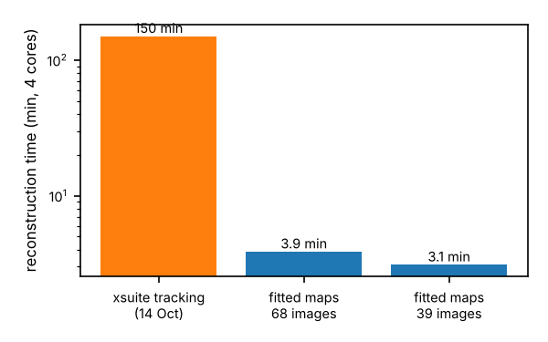
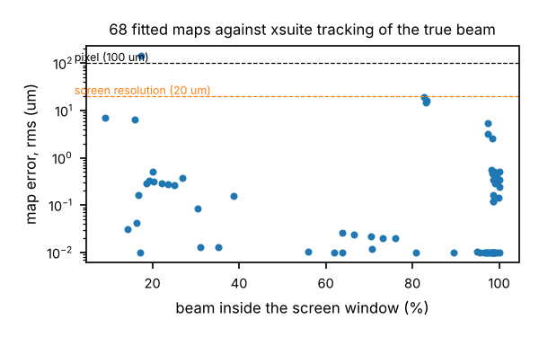
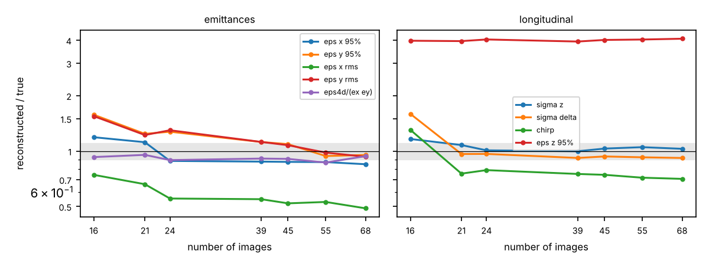
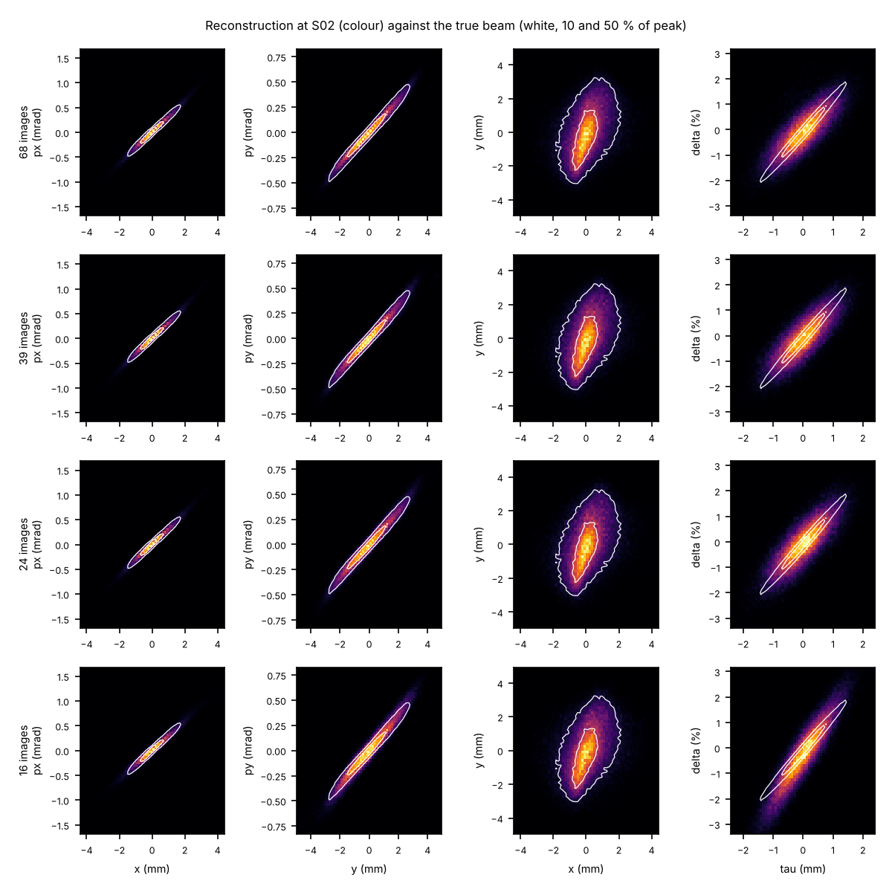
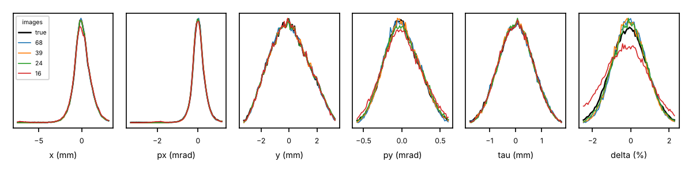

# Fast 6D reconstruction at S02: what it does and why it is fast

## The result in one paragraph

The full 6D reconstruction at the S02 start takes 3 to 4 minutes on 4 CPU cores, against about 2.5 hours yesterday. The reconstruction algorithm itself did not change. What changed is how particles get from S02 to the screens: instead of tracking them through xsuite at every iteration, I fit, once and offline, a polynomial transfer map for every (machine setting, screen) pair, and evaluate those maps as a single matrix product. With 39 images the reconstruction keeps the quality of the full 68-image plan and takes about 3 minutes.

## 1. The reconstruction algorithm

These steps are unchanged in substance from yesterday.

**Goal:** a weighted set of 150k macroparticles at S02 in (x, px, y, py, tau, delta) whose images, pushed through the model to every screen, reproduce the measured images.

1. **MENT reweighting.** Draw particles from a prior. Each particle i lands in pixel p_k(i) on screen k (or in an "outside the window" bin). Its weight is a product of one factor per image, w_i = prod_k h_k(p_k(i)). The h_k are found by Gauss-Seidel sweeps: for each image, h_k(pixel) is multiplied by (measured / predicted) with damping 0.6. This is the maximum-entropy solution relative to the prior (Minerbo; Hoover's particle-sampling MENT, arXiv 2409.17915, uses the same update).
2. **Adaptive prior.** Stage 0 uses a broad, uncorrelated Gaussian, much wider than the beam. After each stage a Gaussian is fitted to the weighted sample, inflated by 10 to 30 %, and used as the next prior. Nine stages are run, then a Nelder-Mead refit of the tau-delta correlation, then three more stages.
3. **Particle resampling.** The weighted particles are resampled with a small Gaussian kernel (0.28 of the rms in each direction) and reweighted again, eight times. This lets the distribution move away from Gaussian (halo, tails).
4. **Chirp scan.** The tau-delta correlation is imposed on a grid (-10 to +22 per m, two slice spreads) and the best by image chi2 is kept, followed by six more resampling stages.

Each step needs the screen pixel of every particle for every image, which means pushing the current particles from S02 through every machine setting. That push is where all the time went.

## 2. Where the 2.5 hours went

Every stage pushed 150k particles through the 19 machine settings with xsuite: about 3 minutes on 4 cores. The pipeline has about 25 stages, plus about 80 trial distributions in the longitudinal refit and 16 in the chirp scan, each needing its own tracking. Tracking was over 95 % of the run time; the MENT sweeps themselves (a histogram per image) take well under a second.

The pushes are wasted work, because the machine never changes during a reconstruction. The map from S02 to screen k under setting c is a fixed function. Only the particles change.

## 3. The speed-up: fitted polynomial maps

For every (setting, screen) pair, the screen coordinates are written as a polynomial in the six start coordinates:

x_screen = sum_m C_xm * z^m,  y_screen = sum_m C_ym * z^m,

with z^m running over all monomials up to total order 5 in (x, px, y, py, tau, delta): 462 terms.

**Fitting (offline, once per machine plan, needs no images):**

- I draw 60k training particles from a Gaussian, track them once through each of the 19 settings with the full xsuite model (TDC kick, RF, dogleg, apertures), and solve a least-squares problem for the coefficients of all 68 screens.
- Two map sets are fitted:
  - **Broad:** order 4, on the broad prior, for the early stages.
  - **Narrow:** order 5, on half that width, used for every particle within 4 sigma of its training distribution, which is all particles after the first stages.
- Each set takes about 2.5 minutes (64 s of tracking plus the least squares). Fitting depends only on the optics plan, so it can be done before the shift.

**Use:**

- "Tracking" N particles through all 68 screens becomes one matrix product, monomials (N x 462) times coefficients (462 x 136): about 2 s for 150k particles, instead of about 3 minutes.
- The 20 um screen blur, the pixel binning and the "outside" bin are applied exactly as before.

**Why a polynomial is enough:**

- The line is linear apart from a few weak nonlinearities: chromatic focusing (delta of a few %), RF curvature (tau of 0.7 mm is 0.04 rad at 3 GHz) and the sine of the TDC kick. A 5th-order Taylor expansion captures all of these.
- Order 4 on the broad training set was not good enough on the dispersive FEA screen (400 to 500 um errors). Order 5 on the narrow set fixed it.

**Accuracy against full xsuite tracking of the true beam:**

- Median rms error 0.1 um.
- 15 to 20 um on the spectrometer screen, at the level of the 20 um screen resolution and well below the 100 um pixel.
- Only the nominal FEH screen is worse (140 um, with 17 % of the beam inside its window).

The literature agrees with this route. The published fast 6D methods are Roussel's GPSR (differentiable tracking on a GPU, 10 to 20 min) and Hoover's MENT with MCMC sampling (minutes per iteration). Both speed up the forward model or the sampling; on a fixed beamline, precomputed maps are the cheapest version of that.

## 4. The fix that made the chirp come out right

The spectrometer setting (FEA screen 01) was re-optimised with all quadrupoles after S05 free, scored by tracking. Previously only the magnets after the DCP screen were free, which fixed beta_y at the TDC.

- Unstreaked y size went from 0.95 mm to 0.16 mm, with a 1.59 mm streak: time resolution about 7 times better.
- The three FEA images were retaken.
- The reconstructed chirp went from -8.6 to +9.5 per m (truth +13.5).

## 5. How many images

| images | what is dropped | time | core eps x | core eps y | eps4d ratio | sigma_z | sigma_delta | chirp |
|---|---|---|---|---|---|---|---|---|
| 68 | full plan | 233 s | 0.85 | 0.95 | 0.94 | 1.03 | 0.92 | 0.71 |
| 55 | nominal optics after S05 | 222 s | 0.87 | 0.94 | 0.87 | 1.05 | 0.93 | 0.72 |
| 45 | third S02 quad setting | 206 s | 0.87 | 1.09 | 0.91 | 1.03 | 0.94 | 0.74 |
| 39 | S07 screens 03 and 04 | 186 s | 0.88 | 1.12 | 0.91 | 1.00 | 0.92 | 0.75 |
| 24 | half the S02 to S05 screens | 161 s | 0.88 | 1.27 | 0.89 | 1.01 | 0.97 | 0.79 |
| 21 | S07 screen 02 | 167 s | 1.12 | 1.24 | 0.95 | 1.08 | 0.96 | 0.75 |
| 16 | second S02 setting | 157 s | 1.19 | 1.57 | 0.93 | 1.16 | 1.59 | 1.30 |

Values are reconstructed / true, one run per set. The truth is used only for scoring.

**The 39-image set:**

- Nominal optics on the 10 screens from S02 to S05.
- Two S02 quad settings on the same 10 screens.
- S07 screen 02 and the DCP screen, each with TDC off, +V and -V.
- The FEA spectrometer screen with TDC off, +V and -V.

## 6. What is still not recovered, and why

- **rms eps_x, about 0.5 of truth.** 1 % of the charge sits in a halo outside the +-5 mm screens. The 95 % core emittance is recovered to 0.85 to 0.9.
- **Slice energy spread and eps_z, about 4 times too large.** On the spectrometer, x is dominated by the linac chirp (delta at S07 = 29 tau0) and by the betatron size. The 1.3e-3 slice spread at S02 adds about 25 um to a 4 mm image, so these screens cannot see it. This is a measurement limit, not an algorithm limit.

## 7. Caveats

- Everything so far uses a perfect model: no hidden magnet errors. The next test is the 39-image set with the hidden errors on.
- There is one run per set. The run-to-run scatter (seed) has not been measured yet, so differences of a few % between rows are within noise.
- The 3 to 4 minutes exclude the 5 minutes of offline map fitting, which depends only on the optics plan.

Code is in `challenges/optimisation/inference/sixd/`: `surrogate.py` (maps), `fast_ment.py` (pipeline and image sets), `design_optics.py` (`refine_all`), `reacquire.py`, `make_figures_fast.py`.
