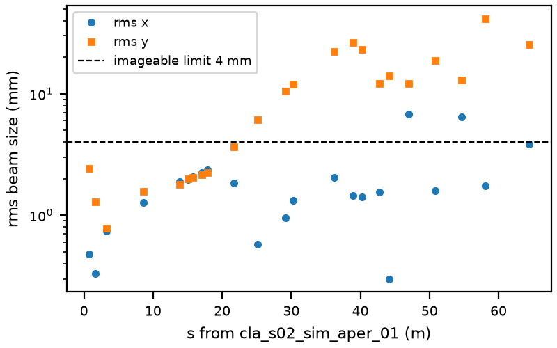
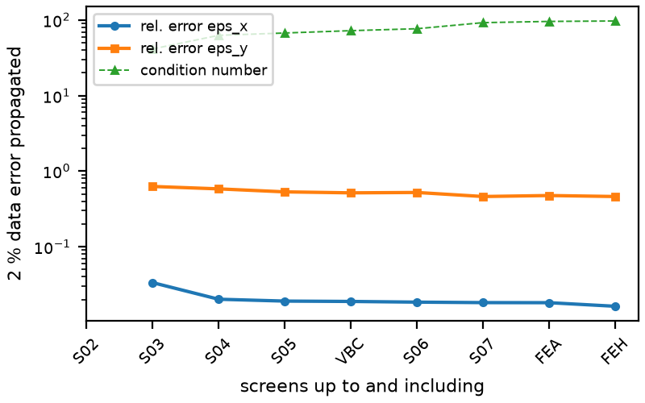
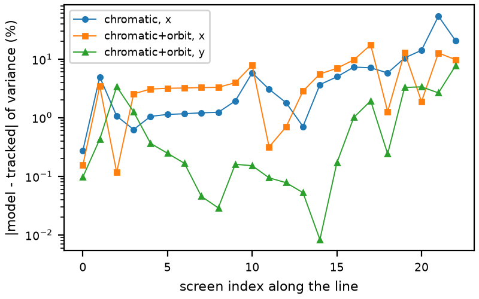
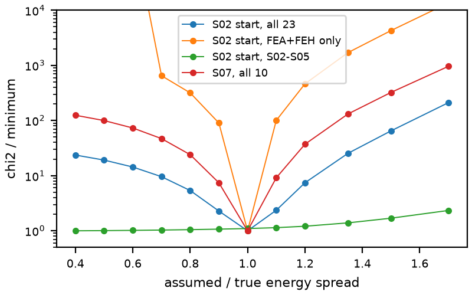

# Screen tomography of the CLARA 4D beam with an xsuite chromatic model

Reconstruction of the full 4x4 transverse second-moment matrix (10 unknowns, x-y coupling included) from the YAG screens along the line, with the nominal optics fixed. Every inserted screen gives (xx, yy, xy) at a different transport map from the reconstruction point, so the set of screens is the scan. The forward model is the xsuite line (cavities included). The inference code reads only machine outputs (`screen_moments`, `read_bpms`); the true beam is used for scoring only. Quad-scan code from the first plan was dropped, except one optional few-quad study (section 6).

## Method

1. **Energy slices.** The longitudinal distribution (tau, delta) at the reconstruction point is taken from the model. A 9-point Gauss quadrature of the delta distribution (Stieltjes/Lanczos on the sample, tau of each node from a cubic fit of the RF chirp) gives slices k with weights w_k. Convergence: 5, 9 and 13 nodes agree to better than 0.1 %.
2. **Maps.** For every slice a reference particle (tau_k, delta_k) is tracked through the line with xsuite and the 4x4 map R_k and the off-momentum orbit D_k are taken at every screen by finite differences (`screen_tomo.slice_response`, one tracking call, 81 particles).
3. **Moments.** `S_screen = sum_k w_k (R_k Sigma R_k^T + D_k D_k^T) - m m^T`, linear in Sigma. Rows are weighted by 1 % shot noise / sqrt(shots) plus a 2 % model floor (more on dispersive rows). Weighted linear least squares, then a positive-definite (Cholesky) refinement.
4. **Orbit awareness.** BPM and screen centroids (31 + 23 positions) give, by a ridge (Bayesian) fit, the launch trajectory, the mean energy offset and the quadrupole offsets (`orbit_fit.py`, prior 100 um). The fitted offsets are installed on the model while the slice maps are tracked. Without this, offsets of the S02 quadrupoles steer the beam by a chromatic kick that acts like a spurious dispersion and spoils the dispersive screens (4x4 variance error up to 50 % at the FEA/FEH x rows).
5. **Resolution** (20 um) is subtracted in quadrature (assumed known).

Files: `screen_tomo.py` (model, fit, metrics), `orbit_fit.py`, `pipeline.py`, `analysis.py` (conditioning and error propagation), `run_s02.py`, `run_s07.py`, `run_bpm_only.py`, `run_augment.py`, studies (`bias_test.py`, `plane_test.py`, `poly_test.py`, `poly_nominal.py`), `make_figures.py`, `make_s07_beam.py` (caches the nominal beam tracked to S07), `results_*.json`.

## 1. Nominal optics: which screens are usable

With the nominal optics only the first 10 screens (S02, S03, S04, S05) have both rms sizes below 4 mm (the screen window is +-5 mm). Not imageable: vbc scr_01 (sy 6.1 mm), s06 (10 to 12 mm), all S07 (sy 12 to 26 mm), FEA (up to 41 mm at scr_04), FEH (sy 25 mm). `screen_moments` returns uncropped moments, so the all-23 results below are the ideal case; with real YAG windows the vertical information from S06 onward would be lost.

## 2. Reconstruction at cla_s02_sim_aper_01 (nominal optics, 3 shots per screen)

True beam: eps_n x/y 8.50/4.07 um, beta 13.2/34.6 m, alpha -4.93/-5.70, x-y correlation 0.320, intrinsic 4D eps_n 3.26 and 9.03 um.

| screens | model | eps_n x (um) | eps_n y (um) | beta x/y (m) | alpha x/y | corr xy | chi2/dof | kappa |
|---|---|---|---|---|---|---|---|---|
| all 23 | achromatic, on-momentum | 8.49 | 6.22 | 13.0 / 22.8 | -4.87 / -3.58 | 0.317 | 87 | 95 |
| all 23 | xsuite slices | 8.32 | 4.81 | 13.3 / 29.3 | -4.97 / -4.73 | 0.315 | 15.5 | 98 |
| all 23 | slices + fitted orbit | 7.89 | 5.90 | 14.4 / 24.0 | -5.37 / -3.76 | 0.312 | 2.5 | 97 |
| all 23 | slices + orbit + dispersive weights | 7.84 | 5.91 | 14.6 / 24.0 | -5.44 / -3.76 | 0.311 | 1.2 | 93 |
| 10 imageable (S02-S05) | slices + orbit | 8.05 | 1.24 | 14.0 / 114 | -5.21 / -18 | 0.320 | 0.06 | 66 |
| S02+S03 (4) | slices + orbit | 8.11 | 5.93 | 13.9 / 23.8 | -5.16 / -3.75 | 0.323 | 0.04 | 41 |
| S02 only (3) | any | underdetermined (9 rows, 10 unknowns) | | | | | | |

What the chromatic model buys: chi2 per dof falls from 87 (achromatic) to 2.5 (chromatic plus orbit), i.e. the chromatic, orbit-aware model explains the 23 screens at the 2 % level, the achromatic one does not. Emittance numbers move by less than the bias of the horizontal plane (below), because the S02 screens (0.93 % spread, no RF) dominate the information.

Findings:

- **Horizontal plane and coupling are good.** eps_x is 6 to 8 % low, beta_x 9 % high, alpha_x 0.4 off, correlation xy within 0.01 of truth, normalised 4x4 matrix error 6 to 9 % (Frobenius, in units of the true rms). With a beam that satisfies the model assumption exactly (Gaussian, independent of delta, same Sigma; an earlier all-screen run gave eps_x -0.6 %, `bias_test.py` on the S02 screens gives -4 % to 0 %), eps_x is recovered, so the 8 % is the true beam's energy-dependent transverse structure (slice eps_x 7.4 to 8.8 um, slices have different orientations) violating the independence assumption.
- **Vertical plane is ill-conditioned.** The true y ellipse is nearly degenerate (|alpha| 5.7, correlation 0.985), so eps = sqrt(det) amplifies a relative Sigma error by about 1/(1-rho^2) = 33. The condition number is moderate (kappa 40 to 100), but 2 % data errors propagate to 46 % in eps_y, and model errors of a few percent move eps_y anywhere between 1.2 and 6.2 um depending on the subset. On nominal optics eps_y, beta_y and alpha_y are not reliable; sigma_y, y-y' correlation and x-y coupling are.
- **Optional fix (section 6):** two to four extra S02 quad settings plus an energy-dependent Sigma model give eps_y 3.9 +- 0.4 um.

### Conditioning per screen subset (2 % relative data error propagated linearly, `analysis.precision`)

| screens up to and including | n | kappa | rel. error eps_x | rel. error eps_y |
|---|---|---|---|---|
| S02 | 3 | rank deficient | | |
| S03 | 4 | 41 | 3.3 % | 63 % |
| S04 | 9 | 63 | 2.0 % | 58 % |
| S05 | 10 | 68 | 1.9 % | 53 % |
| VBC | 11 | 73 | 1.9 % | 52 % |
| S06 | 13 | 77 | 1.8 % | 52 % |
| S07 | 18 | 93 | 1.8 % | 46 % |
| FEA | 22 | 96 | 1.8 % | 48 % |
| FEH (all) | 23 | 97 | 1.6 % | 46 % |

Which screens carry the information (leave-one-out from all 23):

- **S02 scr_01, scr_02, scr_03 and S03 scr_01 are the key screens.** Dropping the whole S02 group raises kappa from 97 to 3000 and eps_x error from 1.6 % to 46 %. Dropping scr_03 doubles the eps_y error (46 to 114 %), scr_02 multiplies the eps_x error by 8, scr_01 is partly redundant with scr_02.
- **Redundant:** the five S04 screens (drift stretch, 0.8 to 1.2 m apart, unchanged beam: removing any one changes kappa by under 2 %, removing all five by 12 %), S05, VBC and the S07 screens. They only add a statistical average over independent noise.
- **Not informative alone:** every single section is rank deficient or kappa above 1e5 (S04 alone 1.5e5, S07 4.9e5, FEA 3.9e5) because the optics between consecutive screens barely change in a drift.
- The dispersive FEA/FEH screens add little to Sigma (kappa 93 to 97) but dominate the energy-spread information (section 5).
- Conditioning improves strongly only by changing optics (section 6).

### Forward-model error floor

Prediction from the true Sigma against exactly tracked variances (orbit-aware model): yy within 3.5 % everywhere except FEH (7.6 %); xx 0.1 to 4 % through S05, 8 % at VBC, up to 17 % at S07 scr_04, 1 to 13 % in FEA/FEH and 10 % at FEH. This (not noise) limits the accuracy, hence the 2 % floor with larger weight on dispersive rows.

### Shots needed (noise replay of the machine noise law, 12 repeats, all 23 screens, 20 um)

| shots/screen | eps_x error | eps_y error | corr xy error | matrix error |
|---|---|---|---|---|
| 1 | -8.1 +- 1.0 % | +51 +- 74 % | -0.010 +- 0.004 | 10.7 % |
| 3 | -8.2 +- 0.5 % | +59 +- 46 % | -0.011 +- 0.002 | 9.2 % |
| 10 | -8.1 +- 0.3 % | +57 +- 21 % | -0.011 +- 0.001 | 9.4 % |
| 30 | -8.1 +- 0.2 % | +62 +- 8 % | -0.011 +- 0.000 | 9.2 % |
| 100 | -8.1 +- 0.1 % | +57 +- 6 % | -0.011 +- 0.000 | 9.2 % |

About 3 to 10 shots per screen are enough: beyond that the scatter vanishes and only the model bias remains (eps_x -8 %, matrix error 9 %). More shots do not help the vertical emittance.

### Robustness to hidden errors and screen resolution (all 23 screens, 3 shots, relative errors)

Grid of hidden quad offsets and launch (launch scale 1 = 300 um, 30 urad, 0.2 % energy):

| quad offset rms | launch | orbit-aware | eps_x | eps_y | matrix error |
|---|---|---|---|---|---|
| 0 | x1 | no / yes | -5.3 / -6.7 % | -21 / -12 % | 5.9 / 6.3 % |
| 100 um | x1 | no / yes | -2.0 / -7.9 % | +75 / +86 % | 6.3 / 11.3 % |
| 100 um | x3 | no / yes | -2.2 / -7.8 % | -15 / -1 % | 5.5 / 8.9 % |
| 300 um | x1 | no / yes | -0.4 / -7.8 % | -8 / +9 % | 5.6 / 22.9 % |
| 300 um | x3 | no / yes | +0.1 / -7.6 % | +26 / +40 % | 7.0 / 18.3 % |

Eight random hidden-error seeds (100 um, launch x1): without orbit fit eps_x -2.7 +- 2.4 %, eps_y +27 +- 51 %; with it eps_x -7.0 +- 0.6 %, eps_y +37 +- 43 %, matrix error 7.9 +- 1.8 %. The orbit fit makes the result more reproducible and brings chi2 to about 1, but a large (300 um) offset makes the fitted offsets (ridge, prior 100 um) overshoot (matrix error 18 to 23 %). Quad offsets move the centroid; the covariance itself is unaffected to first order, so the effect on the result comes only through chromatic steering. Launch offsets alone (zero quad offsets) do not matter beyond noise.

Screen resolution (known to the fit): eps_x -8 to -9 % and matrix error 9 to 12 % from 0 to 200 um (sizes are 0.3 to 3 mm). If the true resolution is 50, 100, 200 um but 20 um is assumed, eps_x changes by about +1, +6, +20 points and the matrix error grows to 13, 14, 35 %: the resolution must be calibrated above about 100 um. All of these numbers are on top of the unreliable eps_y.

## 3. Reconstruction at cla_s07_sim_aper_01 (S07 and FEA/FEH screens, 10 screens)

True beam at S07: sigma 2.40 / 15.3 mm, eps_n x/y 12.4 / 79.9 um (projected, inflated by chromaticity), beta 225 / 1422 m, alpha -26.5 / -101.6, corr xy -0.173.

Nominal optics make all 10 screens non-imageable (sy 12 to 41 mm). Ideal moments: kappa 33 for all 10, but |alpha_y| about 100 gives an emittance amplification of alpha^2 ~ 1e4, so emittance, beta and alpha are not recoverable (predicted error on eps_y: thousands of percent; actual eps_y 55 um vs 80, eps_x 18 vs 12.4, beta_x 155 vs 225). What is recovered: correlation xy -0.175 (true -0.173), normalised 4x4 matrix error 8 % (7 % with five S07 screens alone), sigma and the correlations. S07 screens alone: kappa 226, eps_x 19 vs 12.4 um. FEA+FEH alone: kappa 680. Hidden-error test: matrix error 7 to 13 %, eps_y ranges -18 % to +330 %. If emittance at S07 is needed, change S07 quads (GPSR-style scan of quad_05 and downstream screens); not attempted here because the instruction was nominal optics.

## 4. BPM centroids only (`run_bpm_only.py`, `results_bpm.json`)

Cannot give: any second moment, so no emittance, beta, alpha, coupling or energy spread. The centroid map is independent of Sigma to first order. Numerically, changing the transverse rms by +-50 % moves the 31 BPM readings by 47 um rms through second-order chromatic terms (noise 10 um, but swamped by the hidden quad offsets), so it is not usable as a measurement. With no energy knob the dispersion cannot be measured either: the model dispersion at the BPMs is zero everywhere except the dogleg (FEA BPMs 01, 02, 05, 06: +-0.03 and +-0.009 m per unit delta).

Can give:

- **Trajectory and orbit model.** Launch (x, px, y, py), mean energy offset and the quad offsets. A fit of launch plus energy alone leaves 529 um rms residual (misalignment steering); adding the ridge offsets leaves 1.7 um. Launch is recovered to about 10 um and 8 urad (x 48 um vs 38, px 5.6 vs -4.0 urad, y 204 vs 192 um, py -3.9 vs 3.1 urad); fitted quad offsets have rms 70 um vs 98 um true, and the first four S02 offsets are within 10 to 40 um (the fifth is off by 170 um). The mean energy offset is not determined (est. 2e-3 +- 1.6e-3, true -2e-4).
- **Transfer-map / optics check.** Response of the 31 BPMs to a 200 urad kick of cla_s02_mag_hvcor_01 against the xsuite prediction: 2.5 % rms mismatch at nominal quads (noise floor 0.2 %; the rest is the beam's chromatic spread), 3.7 / 5.8 % for S02 quads scaled by 0.97 / 1.03, 12.5 / 15.7 % for 0.9 / 1.1. So S02 quad calibration errors above about 5 % show up.
- **Orbit-aware forward model:** the fitted trajectory and offsets feed the tomography above.

## 5. Energy spread

Delta was scaled by 0.4 to 1.7 times the model value (0.934 % rms at the start, 2.1 % at S07). The chi2 of the all-screen fit has a sharp minimum at the true value: S02 start, all 23: 166 at 1.0 against 378 / 392 at 0.9 / 1.1, 891 at 0.8, 3176 at 0.5 (0.5 % spread) and 10770 at 1.5. The identification comes from the dispersive and RF-chirped screens: FEA+FEH alone (5 screens) gives 2 at 1.0 against 176 / 196 at 0.9 / 1.1; S07 start, all 10: 27 at 1.0 against 203 / 250. The S02-S05 subset is blind (chi2 0.3 to 0.5 from 0.4 to 1.7), as expected for a drift-and-quad stretch at constant energy. So **sigma_delta is identifiable from the dispersive screens to about 5 to 10 %** (statistical about 1 %, limited by the 2 % model floor and by the orbit estimate), provided the longitudinal chirp and the quad and RF model are right; it is degenerate with a wrong chirp.

A wrong spread of 0.5 % (scale 0.54) instead of 0.93 % changes eps_x from -7.5 % to -2 %, eps_y from +55 % to +65 %, matrix error 8 to 8 %, but chi2 rises 19 times, so it would be flagged. A spread 1.5 times too large gives eps_x -29 % and matrix error 18 %. The horizontal emittance is therefore tolerant of a +-20 % energy-spread error (-5 to -12 %).

## 6. Optional: few S02 quad changes and an energy-dependent Sigma

Because eps_y is ill-conditioned, a design search over S02 quad_01/quad_02 currents (greedy D-optimal on the predicted eps_y error, image sizes below 3.5 mm) gives these extra settings (A) on the S02 screens:

| setting | quad_01 | quad_02 | predicted rel. error eps_y (2 % data error) | kappa |
|---|---|---|---|---|
| nominal 23 | 8.4 | -7.8 | 41 % | 98 |
| +1 | -11.3 | 26.3 | 4.5 % | 71 |
| +2 | -10.9 | 27.1 | 1.1 % | 60 |
| +3 | -8.4 | 18.0 | 1.0 % | 49 |
| +4 | -9.2 | 16.0 | 1.0 % | 40 |

Two extra settings are enough statistically, but the energy-independent model then converges to a repeatable wrong answer (eps_y 1.7 to 1.8 um vs 4.07; eps_x 7.9 to 8.3; matrix error 4 to 5 %): the bias is the model assumption, confirmed with a model-consistent beam (Gaussian, independent of delta): 4.07 / 3.98 um with zero / real hidden errors for five settings on the S02 screens alone. The remedy is an energy-dependent Sigma(delta) = Sigma_0 + (delta - mean) Sigma_1 (still linear, 20 unknowns, weak Gaussian prior on Sigma_1; `fit_polynomial_sigma`, S02 screens + 4 extra settings, 6 repeats of 3-shot data, prior 30):

| | eps_n x | eps_n y | beta x / y | alpha x / y | corr xy | matrix error |
|---|---|---|---|---|---|---|
| true | 8.50 | 4.07 | 13.2 / 34.6 | -4.93 / -5.70 | 0.320 | |
| energy-independent | 8.32 +- 0.18 | 1.76 +- 0.03 | 13.5 / 80.6 | -5.03 / -13.2 | 0.320 | 3.9 % |
| Sigma(delta), prior 30 | 8.5 +- 1.0 | 3.90 +- 0.44 | 13.4 +- 1.9 / 36.6 +- 4.9 | -5.0 +- 0.7 / -6.0 +- 0.8 | 0.321 | 4.5 +- 1.6 % |
| Sigma(delta), prior 100 | 7.9 +- 1.1 | 3.7 +- 0.3 | 14.6 / 38.2 | -5.4 / -6.3 | 0.321 | 6 % |

The prior width matters (prior 1 to 10 returns the biased 1.7 to 3.3 um). On nominal optics alone the energy-dependent model is not stable (eps_y 4 to 7 um with 3 to 5 um scatter). Using the extra settings means changing three or four S02 quad currents, as the user allowed for an ill-conditioned nominal set; the nominal-optics result stands as the default.

Also tried and rejected: assuming independence of delta at the S07 plane instead of the start (backtracking maps through xsuite, `plane_test.py`): chi2 100 to 5e5 and kappa 2e4 to 1e16, unusable.

## Limitations

- The 4D Sigma is accurate (3 to 9 % in normalised matrix error); the projected emittance needs care: eps_x carries a -6 to -8 % bias from the energy-dependent structure of this beam, eps_y is unreliable on nominal optics.
- Transverse-energy independence at the reconstruction point is assumed; the Sigma(delta) extension relaxes it but needs a prior and the extra optics.
- Gaussian slices, linear within a slice, quadrature in delta only; no transverse non-Gaussian tails.
- The model floor (2 to 10 % at FEA/FEH x) caps the gain from more shots; the dispersive FEA/FEH x rows carry unmodelled steering.
- Quad offsets are estimated by a Bayesian ridge fit and degrade for 300 um offsets.
- Energy spread and longitudinal chirp are taken from the model; energy spread alone is identifiable from dispersive screens, the chirp is not tested.
- Resolution is assumed known; errors above about 100 um bias the result.
- A real YAG window removes all vertical information beyond S05 on nominal optics.
