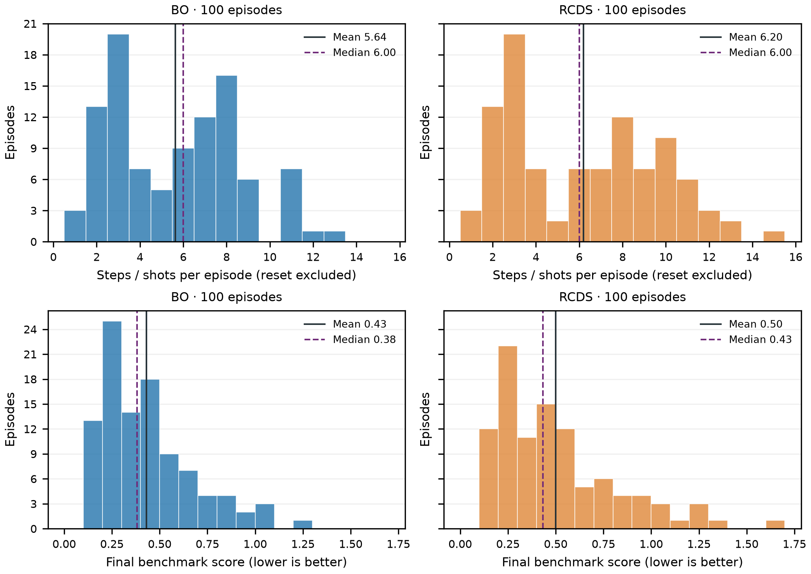

# Adaptive stopping validation

Ran the same 100 Cheetah episode seeds (42–141), 10,000 particles, centered (1, 1) mm targets and 0.1% supply ripple. Each method independently resets to the same seed; every proposal is a fresh single-shot measurement. All 200 branches completed with beam on the IP; screen changes were zero.

| Method | Mean shots | Median | 10th–90th percentile | Range | Mean score |
|---|---:|---:|---|---|---:|
| BO | 5.64 | 6 | 2–9 | 1–13 | 0.430 |
| RCDS | 6.20 | 6 | 2–11 | 1–15 | 0.500 |

Shots exclude one reset reading per branch and include all corrections/restorations. There are no replay acquisitions or automatic three-shot verification batches. Total measured steps: **1,184**, versus 38,434 in the original fixed-budget experiment (which also included discovery/replay and two interrupted episodes). Each successful former branch used 192 shots; reductions in the mean per-branch count are 97.1% for BO and 96.8% for RCDS.

The stopping policy emulates MBRL's focus tolerance 0.15 and patience of three significant non-improvements; BO additionally stops when expected improvement is below the benchmark cost of another shot. The size model refines its proposals offline within the same five singular modes. Screen centering uses the final four correctors, first by inverse response, then by measured response-gain correction if needed, with RCDS only for the remaining residual.

## Residual quality

On matched seeds, mean physical mismatch excluding shot cost changed from **0.431 to 0.356 for BO** (99 pairs), and **0.356 to 0.415 for RCDS** (98 pairs). The earlier run averaged three final verification shots; the new run scores its last actual single shot, so this is a descriptive comparison rather than proof of a latent-quality change. RCDS trades some residual quality for shot economy.

Completing a branch means the camera reads surviving beam, not that all requested tolerances were met. The strict final check (each RMS size within 15%, each centroid within 0.1 requested RMS, on-screen fraction at least 90%) passed on **30 BO** and **26 RCDS** episodes. The aggregate focus stopping rule is different from that strict final check, and a later centering shot redraws the stochastic beam.

BO benchmark relative-error hit rates: 10% tolerance: 51%, 25% tolerance: 87%, 50% tolerance: 99%.

RCDS benchmark relative-error hit rates: 10% tolerance: 44%, 25% tolerance: 77%, 50% tolerance: 97%.

## Compute timings

| Method | Mean ± SD | Median | 10th–90th percentile |
|---|---|---|---|
| BO | 4.14 ± 1.39 s | 4.56 s | 2.36–5.56 s |
| RCDS | 4.01 ± 1.37 s | 4.44 s | 2.27–5.45 s |

These are local per-method simulation/model/optimizer **compute times**, including environment setup/reset and the method's tuning stages. Shared nominal response calibration is excluded from those branch times. The full batch, including shared setup and export, took **177.78 s (2.96 min)** with eight parallel workers. These values do not include real-machine setting, settling or camera-acquisition delays.

The audit reconciled step/reset counts, score values, native settings, five-mode optics membership and the final-four-corrector restriction; all 18 workflow tests pass. See [RESULTS.md](RESULTS.md) for the current result index and talk histogram exports.

[Compact episode metrics and statistics](results/latest_results.json) · [Audit](results/audit.json)

Raw measured-shot data and superseded runs were removed during cleanup.

