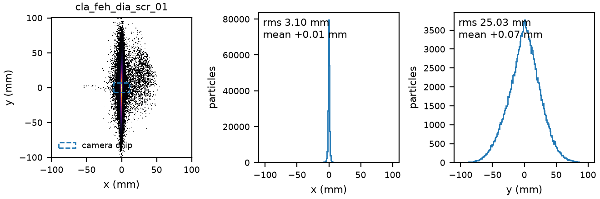
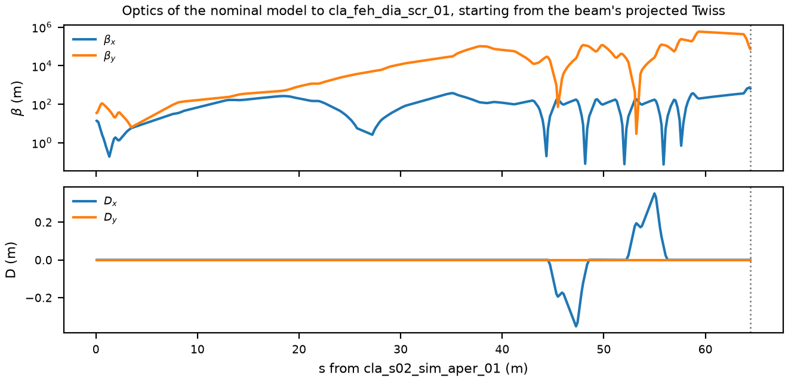

# Nominal model for the optimisation challenge

An xsuite model of CLARA from the benchmark start (`cla_s02_sim_aper_01`) to the readout screen (`cla_feh_dia_scr_01`), with the magnet strengths of the lattice file, and a starting beam derived from the 4D phase space measured at S07. It is the starting point for the optimisation work: the beam is the best estimate of what CLARA delivered, and the lattice is the one the optimiser has to fix.

## Contents

| File | What it is |
|---|---|
| `xsuite_model.py` | the model: converts the Cheetah lattice JSON to an xsuite line, tracks forward and backward, computes optics from test particles, reads and writes distributions |
| `initial_distribution.npz` | the nominal starting beam: 200,000 particles at `cla_s02_sim_aper_01`, 35.8055 MeV |
| `example_nominal_model.py` | how to use it: tracks the beam to the readout, plots the screen and the optics into `figures/` |
| `make_initial_distribution.py` | how the starting beam was built, with an `--longitudinal astra` variant |
| `make_gpsr_lattice.py`, `CLARA_cheetah_S07_GPSR.json`, `s07_gpsr_tune.json` | the magnet settings of the 23 March 2026 S07 quadrupole scan, used to build the starting beam |
| `requirements.txt` | package versions the model was validated with |

## Quick start

```bash
pip install -r requirements.txt
python example_nominal_model.py
```

The first run compiles the kernel of the custom RF-focusing element, which takes a few seconds. In your own code:

```python
import xsuite_model as model

start, energy_ev, metadata = model.load_distribution()  # (N, 6) at cla_s02_sim_aper_01
converted = model.build_line(energy_ev)  # lattice-file strengths, start to readout
final = model.track_forward(converted, start)  # (N, 6) at cla_feh_dia_scr_01
# beta, alpha and D along s, starting from the beam's projected Twiss
optics = model.optics_along(converted, model.twiss_from_coordinates(start))
```

`build_line` also takes `lattice_json=` (any Cheetah lattice JSON with the CLARA_FEBE sequence) and `end=` (any element name). To change a magnet during an optimisation, set it on the xsuite line directly, for example `converted.line["cla_feh_mag_quad_01"].k1 = 2.0`; magnets keep their Cheetah names, while cavities are split into pieces named `<cavity>..*`.





## The starting beam

The transverse plane comes from measurement: the GPSR reconstruction at `CLA-S07-SIM-APER-01` (`data/clara/lattice_data/CLA-S07-SIM-APER-01.hdf`), made from the scan of S07-QUAD-05 on 23 March 2026. The longitudinal plane comes from the model: `score.sample_beam` at severity 0 is injected at the start and tracked forward to S07, and its (τ, δ) are attached there to the reconstructed particles at random. The 6D beam is then tracked back to the start in xsuite through the magnet settings that were on the machine during the scan (`CLARA_cheetah_S07_GPSR.json`). Tracking it forward again returns the reconstruction to 7 × 10⁻¹³ of its rms. Finally the beam is centred (see below).

| At `cla_s02_sim_aper_01` | x | y |
|---|---|---|
| β, α | 13.2 m, −4.93 | 34.7 m, −5.73 |
| εn projected | 8.42 µm | 4.03 µm |
| εn in energy slices | 7.6 to 8.3 µm | 2.9 to 3.2 µm |
| σ | 1.26 mm | 1.41 mm |

σz is 0.688 mm, σδ 0.934 %, and the x–y correlation +0.31 (it comes from the reconstruction).

The projected emittances are larger than in any single energy slice because each slice has its own orientation in phase space, which the chromatic transport to S07 lines back up; each slice carries the measured emittance. A beam without these energy-dependent correlations, given the same 0.93 % energy spread, would reach S07 39 % above the measured vertical emittance and 7 % above the horizontal one. The real energy spread during the scan therefore matters, and it is not known yet.

This beam is far from the one in `score.sample_beam`: its normalised emittances are 3.6 (x) and 1.7 (y) times larger, and its x–y coupling is absent there.

The beam is centred at the start in x, x′, y and y′, so errors (offsets, jitter, misalignments) can be added on top of an on-axis beam. The backtracked beam was off axis by +0.22 mm and +0.04 mrad in y (−0.04 mm and −0.02 mrad in x), from the reconstruction's small offset at S07; that offset is removed after the closure check and stored in the file's metadata (`removed_offset_x_px_y_py`). With the lattice-file strengths the centred beam arrives at the readout within 0.1 mm of the axis; the remainder comes from chromatic effects.

## The nominal magnet strengths

`build_line` uses the strengths stored in `data/clara/lattice_data/CLARA_cheetah.json`: FEA dogleg on with its dispersion closed at the readout, sextupoles and correctors at zero, VBC chicane on at 131.7 mrad, a parallel-face chicane with the inner dipole faces at the bend angle (STFC's SimFrame VBC.yaml). In this model that angle gives R56 = −57.6 mm, the maximum compression into FEBE measured on CLARA (IPAC THP2100). These optics are not matched to this beam. At the readout the beam is 3.2 × 1.7 mm rms (it was 3.1 × 25 mm with the chicane flat), and the energy spread (2.1 % at S07) inflates the projected emittance. That is the problem the optimisation has to solve.

The starting beam was built through the scan settings because those produced the measured phase space. At the start it is just a beam, and it can be tracked through any settings.

## Variant: the ASTRA longitudinal plane

```bash
python make_initial_distribution.py --longitudinal astra --output initial_distribution_astra.npz
```

builds the same beam with the longitudinal shape of `S02_input_beam.astra` (σz 0.506 mm, σδ 0.506 %), centred on its own reference particle and applied around the 35.8055 MeV reference energy (the ASTRA reference is 35.31 MeV). With the smaller energy spread the projected emittances drop to 8.07 / 3.32 µm, with slices of 7.0 to 8.3 / 2.89 to 2.93 µm, and βy becomes 41.7 m. With the chicane flat, the rms size at the readout was the same, 3.1 × 25 mm, and the projected emittance 25 % lower. It is not the default until we know which longitudinal plane CLARA had during the scan.

## Model details and limits

- The xsuite line tracks thick elements with each particle's own momentum (xsuite's default paraxial maps), and models the standing-wave cavities with Rosenzweig–Serafini focusing applied at each particle's energy. It reproduces Cheetah's 4×4 map within 1 × 10⁻⁴ to S07 and 5 × 10⁻⁴ to the readout, and Cheetah's reference energy exactly (the on-axis particle ends 2 × 10⁻⁵ below it, an effect of the cavity slicing). The benchmark's scorer runs Cheetah with first-order magnets and achromatic cavities, so off-momentum particles behave differently there: with the cavities replaced by drifts, xsuite and Cheetah at second order agree within 2 %; with them, xsuite shows 45 to 55 % more chromatic emittance growth to S07.
- There are no screen images; read beam positions from the coordinates.
- Apertures are off by default. `build_line(..., apertures=True)` and `cheetah_segment(..., apertures=True)` add the vacuum chamber of `data/clara/lattice_data/apertures.json`, taken from STFC's SimFrame model of CLARA FEBE: a 17 mm half-aperture pipe, 10 mm in the S-band linacs, 4.12 mm in the X-band linearizer L4H, 5 mm in the TDC, 34 x 17 mm in the FEA dipoles, the 10 mm S02 collimator, and the ~68 mm radius of the FEC1 quadrupoles from the PRAB paper (PRAB 27, 041602) from `cla_feh_mag_quad_01` on. The 5 mm tungsten mask in the FEA arc is not modelled. The beam is checked at each chamber change and at the exit of every element with a length. `track_forward` raises when particles are lost, so track the line directly (`converted.line.track`) and read `particles.state` when apertures are on. Cheetah and xsuite agree on the losses: the nominal beam keeps 72 % to the readout through the lattice-file strengths, all of the loss upstream of the VBC, mostly in L4H (27 %); with the VBC chicane flat it keeps 13 %, and at 118.5 mrad 59 %. The scorer still uses its own 50 mm pipes at the screens.
- `optics_along` does not use xsuite's twiss, which does not apply to an accelerating line. It tracks test particles and starts from the projected Twiss of the beam.
- Energy at the VBC: the lattice file's cavities bring the reference beam to 181.6 MeV there, while `data/clara/lattice_data/utils.py` converts VBC (and S05, S06) magnet currents at `beam_energy` 196.6 MeV. Strengths converted from currents in that region are therefore about 8 % off for this model, and the current-based knob range of the VBC (100 A ≈ 115.6 mrad at 196.6 MeV) is about 8 % narrower than at 181.6 MeV. Logged, not corrected.
- Coordinates are in Cheetah's convention: x and y in m, px and py canonical over the reference momentum, τ = −ζ in m, δ relative.

Open points that can change this beam:

1. The reconstruction file carries a placeholder pz (0.86 MeV/c); positions and angles are assumed right.
2. `utils.beam_energy` converts the S02 currents at 32.8 MeV, the model has 35.8 MeV there; rescaling the S02 quadrupoles moves βy at S02-SCR-01 by about 40 %.
3. The RF readbacks of the scan are not applied (they are machine phases). During the scan the 4HC linearizer was off and L04 ran at lower power, so the model's longitudinal plane is a stand-in.
4. Whether the x–y correlation of the reconstruction (−0.48 at S07) is real.
