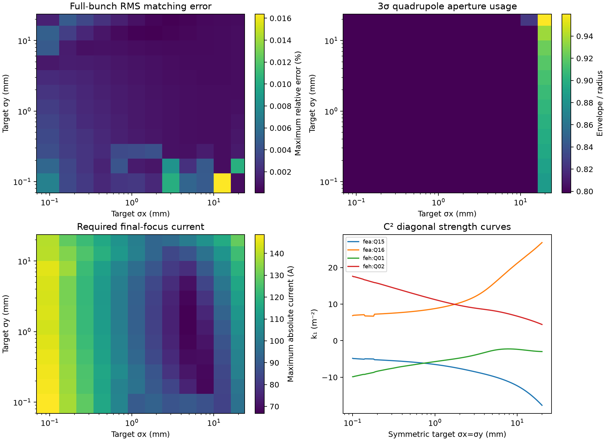

# Smooth aperture-constrained IP spot-size optics

A matched family covers all **144 requested targets**: 12 logarithmically spaced
RMS sizes from **0.1 to 20 mm** in each plane. The target is
`cla_feh_dia_scr_01`, VBC excitation is zero, wakes are off and L4H is off.
The saved nominal 200,000-particle bunch is used throughout.

The 12 sizes in each plane (mm) are:

`0.1, 0.161877, 0.262041, 0.424183, 0.686654, 1.11153, 1.79932, 2.91267, 4.71494, 7.6324, 12.3551, 20`

## Result and scope

All 144 grid settings pass independent full-particle Xsuite validation. Maximum
relative spot-size error is **0.01639%**.
All 200,000 particles survive these final-family validations.

The 3σ aperture ellipse uses the full transverse covariance, including x–y
correlation, and the centroid. A conservative circular bound is enforced:

```
||mean(x,y)|| + 3 sqrt(lambda_max(Cov(x,y))) <= aperture_radius
```

Radii are 68 mm for FEH Q1/Q2 and 20 mm for every earlier quadrupole. Body
sampling is included. Maximum full-particle aperture use is
**0.959998** of radius. A denser 65-station body check
in the matching model gives **0.960235**; this leaves
approximately **3.976%** radial headroom.
The common 42-quadrupole prefix is separately checked by full-particle tracking.

These are RMS sizes about the beam centroid. No alpha/waist or IP-centroid target
is imposed. Aperture constraints apply to quadrupoles; camera field of view and
unprovided apertures of other devices are not used as clipping constraints.

## Quadrupole-current assumption

This complete family imposes the supplied aperture constraints, without an
additional ±100 A quadrupole limit. The earlier ±100 A chicane limit is retained.
The inference virtual-machine code separately assumes ±100 A for quadrupoles;
that extra constraint was not specified for this matching request. The question
about applying it here is recorded in the chat.

Required calibrated currents reach **148.667 A** in
magnitude. **77 of 144** grid settings exceed
100 A in at least one of the four variable quadrupoles. The saved settings are
therefore an aperture-feasible model family; they do not establish hardware
feasibility under a 100 A quadrupole limit. This is not a proof that other
families could not cover more of the range with that additional limit.

| Variable quadrupole | k1 range (m^-2) | Calibrated current range (A) |
|---|---|---|
| `cla_fea_mag_quad_15` | -17.66156 to -4.22176 | -83.735 to -19.911 |
| `cla_fea_mag_quad_16` | 5.73492 to 26.82633 | 26.977 to 129.388 |
| `cla_feh_mag_quad_01` | -10.70645 to 3.95071 | -89.330 to 32.950 |
| `cla_feh_mag_quad_02` | 4.43417 to 17.61698 | 37.010 to 148.667 |

The complete 46 strengths, including all fixed-prefix magnets, are saved per
target in `quadrupole_settings.csv`. Apply the whole setting dictionary.

## Smooth family and reduced controls

The first 42 quadrupoles share a retuned common prefix. Four final-focus magnets
vary with the desired spot sizes: FEA Q15/Q16 and FEH Q1/Q2. This keeps the
upstream beam transport and aperture use fixed as the target changes.

The initial top-five global SVD control trial did not cover the full grid with
the required apertures. A simple first-order covariance match also failed an
independent tracking check because of chromatic effects. The delivered family
uses energy-resolved conditional moments of the tracked nominal bunch. Only
four quadrupoles and drifts remain after the cached full-particle prefix, so
this final transverse transport retains each beamlet's momentum dependence.
Full-particle validation measures the remaining approximation error directly.

A 23×23 auxiliary grid selects a coherent phase branch around a smooth reference
field, with the requested 12×12 grid included exactly. Bicubic strength surfaces
are fitted in log(sigma_x), log(sigma_y). A fixed six-step analytic Gauss–Newton
correction of the four final strengths enforces the requested RMS sizes between
knots. It uses a smooth bounded step and a regularized 2×2 inverse, with no
adaptive iteration count or control switching. The resulting parameterization
is C² in the positive log-size domain. **Raw bicubic interpolation alone is not
the matching parameterization**; it is too inaccurate near tightly focused
spots. Use the provided API with its default refinement enabled.

The corrected surface was checked at **2025** size pairs.
Largest model spot error was **1.01e-09** relative;
maximum aperture ratio was **0.960000**.
Analytic strength derivatives agree with finite differences to
**5.48e-11 m^-2** in the tested log-size derivative.

Another **23 off-grid settings** were independently tracked with all
200,000 particles. Their maximum spot-size error was
**0.01345%**, and maximum aperture use
**0.875974**. See `off_grid_validation.csv` for each case.
Validation tests the saved nominal bunch and RF configuration; it is not a
jitter or machine-error tolerance study.

## API

Run from the repository root; sizes are in metres and strengths in m^-2:

```python
from inference.optics.matching.matched_optics import MatchedOptics, CompressionEffects

model = MatchedOptics()
tune = model.evaluate(1e-3, 3e-3, derivatives=True)
settings = tune["settings"]              # all 46 quadrupole k1 values
Jx = tune["d_k1_d_log_sigma_x"]           # derivative of the smooth matched strengths
Jy = tune["d_k1_d_log_sigma_y"]

# The external-field fractional-beta response at these matched strengths:
response = model.optics_response(1e-3, 3e-3)
R = response["response"]                 # 46 rows x 46 quadrupole columns
A = response["weighted_response"]
```

The response retains the earlier IP weighting: each IP-plane row has weight
1/4, and each upstream screen-plane row 1/88. It is the external-field beta
response, distinct from the full-bunch RMS matching objective. A tracked xsuite
prefix map and its k1 derivatives are composed with the analytic four-magnet
tail. `response_validation.json` compares it with fresh tracked finite
differences. The upstream screen rows are constant across this family; the two
IP rows vary smoothly. This supplies the requested spot-size dependence of the
optics response without repeating a full response calculation at each query.

The API rejects sizes outside 0.1–20 mm. Numerical tracking is not required at
query time; NumPy, SciPy and PyTorch are sufficient. Derivatives are optional.
The source modules and the three small numerical bundles are portable; the
full 200,000-particle prefix files are only needed for independent validation.

## Saved compression effects versus strength

`compression_strength.csv` and `.npz` contain 101 no-wake tracking settings for
this family's common upstream tune. Strength u is theta/theta_max in [-1,1],
with the coordinated bend pattern (+theta,-theta,-theta,+theta). The table
includes each dipole current, RMS length, compression factor, central charge
widths, peak current in 10 μm bins and skewness. The compression definition is
sigma_tau(VBC entrance)/sigma_tau(DIP04 exit).

```python
compression = CompressionEffects().evaluate(0.8)
print(compression["compression"], compression["sigma_tau_m"])
```

These effects at the compressor do not depend on the four downstream spot-size
controls. The spot-size matching surface itself is fitted at zero VBC
excitation; a nonzero VBC setting still requires extending the matching model.
The earlier nominal-quadrupole compression data are separately archived in
`inference/optics/vbc_full_scan/compression_strength.csv`; the new table uses the
retuned common prefix, so both provenances are preserved.

## Files

- `quadrupole_settings.csv`: requested and tracked sizes, all 46 k1 settings,
  aperture usage and required final-focus currents for the 144 requested nodes.
- `matching_grid.npz`, `validated_grid.npz`: 12×12 model and full-particle results.
- `matching_surface.npz`: auxiliary 23×23 C² strength-surface knots.
- `beamlet_runtime.npz`: portable momentum-resolved moment model for the smooth
  matching correction; this is part of the parameterization.
- `optics_response_model.npz`, `response_validation.json`: fast response model
  and direct-tracking comparisons.
- `external_optics_profiles.npz`: external-field beta, alpha and dispersion
  along the line for all 144 settings, calculated separately from bunch moments.
- `anchor_lattice.json`, `anchor_settings.json`: complete symmetric 1.414213562 mm
  tune. Use `wakefields=False` with the xsuite converter.
- `apertures.json`: the supplied radii and the precise envelope rule.
- `compression_strength.csv`, `compression_strength.npz`, `compression_metadata.json`:
  effects versus chicane excitation for the common matching prefix.
- `summary.json`, `dense_surface_checks.csv`, `off_grid_validation.*`,
  `common_prefix_validation.json`, `full_start_validation.json`: accuracy and
  aperture checks, including full-line corner runs without prefix caching.
- `provenance.json`: hashes of the nominal inputs and numerical bundles.


