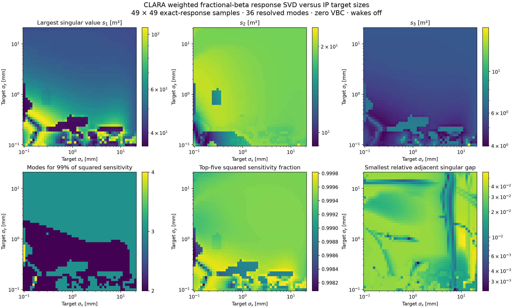
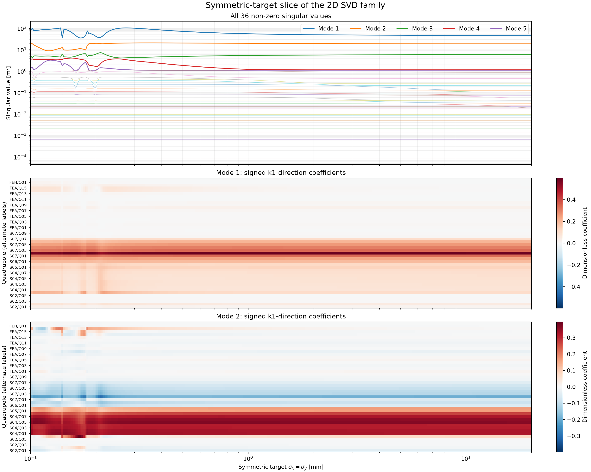

# Weighted optics SVD versus two target beam sizes

The 2D family covers **sigma_x and sigma_y independently from 0.1 to 20 mm**,
at `cla_feh_dia_scr_01`, with zero VBC excitation, wakes off and L4H off.
This is an SVD of the **fractional external-field beta response to quadrupole
k1**, evaluated at the previously matched optics. It is not a beam-size response
or a derivative of the matching strengths with respect to the requested sizes.

All 46 quadrupoles are perturbation variables, including the 42 whose base
settings are constant across the matched family. Rows are x/y at 22 upstream
screens plus the IP proxy. The matrix is 46×46:

```
R[row,j] = d ln(beta_plane_at_screen) / d k1_j
A = sqrt(row_weights)[:,None] * R
A = U @ diag(s) @ Vt
```

The IP has half the total squared-error weight: each of its two rows has weight
1/4; each of the 44 upstream rows has weight 1/88. No column scaling or current
conversion is applied. `s` has units m², `Vt` rows are dimensionless directions,
and modal amplitudes have units m⁻².

## Result and interpolation

The saved **49×49 logarithmic grid (2,401 optics configurations)** resolves
**36 modes**, using a relative rank cutoff of 1e-10. The smallest retained
singular value is about 8.85e-5 m²; the largest discarded value is about
6.53e-11 m². The last ten vectors are numerically unresolved and are omitted.
On the sampled grid, **two to four modes capture 99% of squared sensitivity**;
the first five capture at least **99.808%**.
`grid_svd.npz` saves all 46 singular values, the 36 retained right vectors,
weights, names and the varying weighted response rows.

Tensor-product cubic splines in log(sigma_x), log(sigma_y) are compiled for
the two varying response rows and the sign-aligned right-vector field. The
44 upstream response rows are constant. Maximum-overlap spanning trees align
vector signs without permuting the descending singular-value order.

**The default API refines the interpolated SVD with the existing analytic
response at the smoothly corrected matching strengths.** Re-diagonalization
retains orthonormal vectors and sorted singular values. The vector splines
provide a deterministic local sign gauge. This requires only the small saved
moment/response model, not particle tracking or new Xsuite runs.

This refinement is essential. On 128 off-grid checks, raw 49×49 response
interpolation reached approximately 300% relative matrix error and large mode
rotations near sharp focusing features. `exact_response=False` exposes this
raw interpolant for diagnostics only; it is **not an accurate replacement**
for the default mode parameterization. The default reconstruction error is
at most 1.57e-12 relative, with orthogonality error below 9.4e-15 on these checks.
The physical response model retains the previously documented Xsuite
finite-difference validation; these are additional numerical SVD checks.

## Smoothness: local vectors and global subspaces

A globally smooth, individually sorted singular-vector field **does not exist
across the entire domain** for this response model. Numerical searches located
three degeneracies, with relative gaps below 4e-12:

| Modes | sigma_x (mm) | sigma_y (mm) |
|---|---:|---:|
| 7–8 | 1.23762 | 0.33590 |
| 9–10 | 0.27815 | 1.16733 |
| 20–21 | 5.23106 | 17.42113 |

These are examples, not an exhaustive degeneracy search. Continuous sign
transport around a small closed loop enclosing each example returns **both
vectors with opposite sign**, with no unresolved transport segments. The
corresponding combined two-mode projector returns unchanged. At a degeneracy,
individual vectors are not unique; rotating the pair is equally valid.
This prevents an honest promise of one globally smooth oriented vector spline.

Away from degeneracies, sorted vectors are locally smooth. For a trajectory in
size space, use `transport_path` or pass the preceding `Vt` as `reference_Vt`.
For sign-independent quantities use `projector`; a grouped projector remains
smooth through internal degeneracies while its group is separated from the
remaining spectrum. Projectors also avoid arbitrary sign seams.

The `gauge_overlap` output flags poor alignment with the spline sign gauge.
`relative_singular_gaps` describes neighbouring sorted-mode separations.
The grid continuity report includes edge angles, unresolved sign plaquettes
and remaining sign seams; these coarse-grid diagnostics alone are not evidence
of a degeneracy. `degeneracies.json` additionally contains the numerical
minimizations and closed-loop sign tests.

## API

Run from the repository root; sizes below are in metres:

```python
import numpy as np
from optics_matching import SizeModes

model = SizeModes()
result = model.evaluate(1e-3, 3e-3, n_modes=8)
s = result['singular_values']           # descending, m²
Vt = result['Vt']                       # (8,46), orthonormal k1 directions
U = result['U']                         # (46,8), weighted screen directions
variables = model.ranked_variables(1e-3, 3e-3, n_modes=8)
n99 = model.n_modes_for_fraction(1e-3, 3e-3, .99)

# Transport signs continuously along a specified path.
path = np.array([[1e-3, 3e-3], [2e-3, 3e-3], [2e-3, 4e-3]])
transport = model.transport_path(path, n_modes=8)
frames = [r['Vt'] for r in transport['results']]
assert transport['unresolved_segments'] == 0

# Projector onto the combined modes 7–8 (1-based, inclusive indices).
P78 = model.projector(1.23762e-3, .33590e-3, 7, 8)

# Convert local modal amplitudes into all 46 absolute k1 settings.
k1 = model.to_k1([1e-4, 0, -2e-4], 1e-3, 3e-3)
coordinates = model.from_k1(k1, 1e-3, 3e-3)
```

A finite modal perturbation generally changes the requested beam sizes and may
violate apertures; modes describe local sensitivity, not a new matched family.
Signs of modal amplitudes must use the same frame as the vectors. Sizes outside
the supplied domain are rejected. Matching/current limitations in the parent
README still apply.

## Reproduce and inspect

```bash
nominal_model/.venv/bin/python -m optics_matching.build_size_modes
nominal_model/.venv/bin/python -m optics_matching.check_size_degeneracies
nominal_model/.venv/bin/python -m optics_matching.validate_size_modes
nominal_model/.venv/bin/python -m optics_matching.plot_size_modes
```

`build_size_modes --source optics_matching/results/size_svd/grid_svd.npz`
reuses the saved response grid. The runtime compiled bundle is
`../../data/size_modes.npz`. `dominant_variables_examples.json` provides ranked
mode coefficients at four representative size pairs. `heldout_validation.csv`
and `validation.json` quantify raw interpolation and default refinement;
`api_validation.json` checks every knot, modal round trips and projectors.




